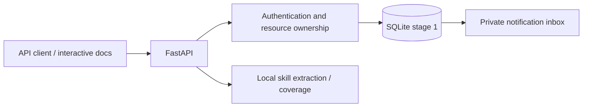
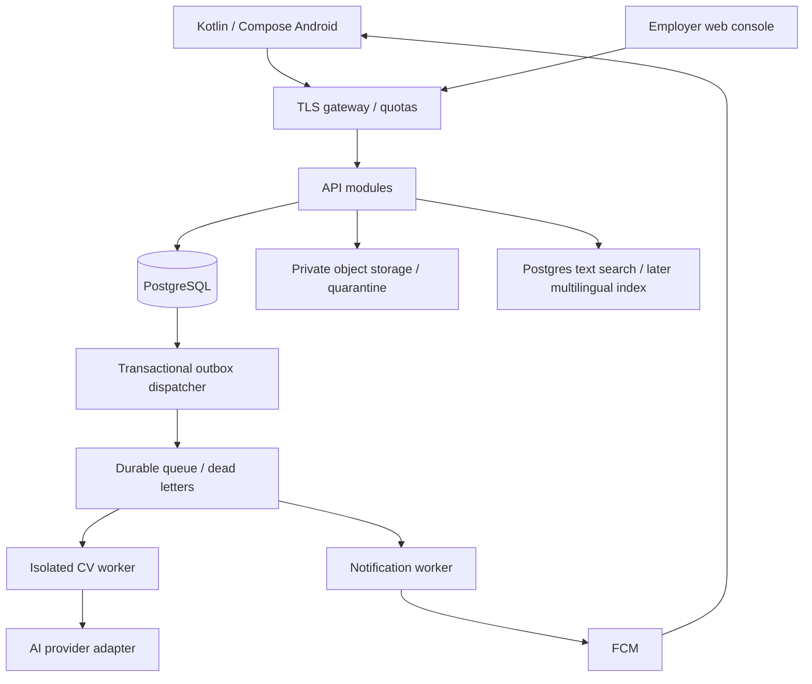

# IyoJobs architecture

## Current, executable stage

Python 3.12+ / FastAPI modular monolith; SQLite transactions; opaque one-hour bearer sessions; REST/OpenAPI. No external AI, mail or push credentials. `create_app` is an application factory: tests use isolated temporary databases. The service creates the version-1 schema idempotently on first launch. Subsequent schema changes must introduce ordered migration scripts; editing an existing schema is not a migration.

There is no production web frontend or Android binary in this stage. JSON supports Unicode and locale fields; complete localization belongs to client delivery. SQLite LIKE/lower are not a complete multilingual search engine. Pagination is bounded, offset-based and ordered by stable IDs; use keyset pagination before high volume.

## Target architecture

Start with one deployment region, one API, one worker and managed PostgreSQL. No microservice split until measured contention or security boundaries require it. Redis may back distributed rate limits; it is not the source of truth for applications. Independent web and Android clients use the same versioned API contract.

## Key decisions

1. PostgreSQL is the beta target, SQLite the tested local milestone. Before migration: explicit migrations, timezone-aware timestamps, backup restore and cross-tenant integration tests against PostgreSQL. Do not silently switch connection strings with current SQLite code.
2. First-party company jobs first. Licensed sources integrate through adapters with provenance, source IDs, expiration, deduplication and revocation rules. No imported JobOps adapters.
3. Object storage uses random object IDs, private ACLs, short-lived scoped URLs; quarantine cannot be read by recruiters. Worker has no network access except the explicitly approved provider endpoint.
4. AI runs asynchronously; API returns 202 plus task ID. Client sees queued/running/failed/completed; retries cannot create duplicate charges. Cancel/timeout semantics and versioned result storage precede release.
5. Every private query is scoped to actor and organization membership. Role checks alone are insufficient. Current ownership is one employer per company; teams require membership and invitation models.
6. Write application update and outbox event in one database transaction. Delivery is at least once with event ID deduplication. Lease-based claims, exponential backoff with jitter, maximum attempts and dead-letter review. Do not promise exactly-once delivery.
7. In-app inbox is authoritative. FCM is a wake-up hint; app fetches authorized content after authentication. Remove invalid tokens, rotate on refresh, revoke on logout. Never send CV, offer salary or message text in push payloads.
8. Production release is deliberately absent from CI. A future workflow requires protected environment, reviewer approval, immutable artifact digest, migrations with rollback strategy and owner approval for that release.

## API contract

Executable OpenAPI is `/openapi.json`; Swagger is `/docs`. Development endpoints have no /v1 prefix yet: freeze or version before external clients ship. 401 invalid/missing session; 403 role violation; 404 absent or inaccessible private resource; 409 conflict/state violation; 422 invalid request; 429 quota. Error codes are localization keys, not user-facing translated strings. Add request IDs and standardized envelopes before beta.

Current routes cover auth, /me/profile, /me/cv/analyze, companies, jobs/search/close/match, applications/status/messages and /me/notifications. Lists enforce limits. Production additionally needs email verification, invitations, moderation, file uploads, device tokens, privacy export/deletion and durable tasks.

## Android delivery contract

Kotlin + Jetpack Compose; ViewModel state, repository layer and generated or typed API client. Android Keystore-backed token encryption, HTTPS only outside debug, no secrets in APK. Room caches public job summaries; private CV caching off by default. WorkManager retries eligible background sync; foreground refresh reconciles inbox. Support Arabic RTL, English and French resources, TalkBack and text scaling.

FCM setup requires user-owned Firebase project and app registration; request runtime notification permission where required, create notification channels and handle foreground/background/terminated states. [Official setup](https://firebase.google.com/docs/cloud-messaging/android/get-started). Acceptance is a signed internal-test build exercised on emulator and physical Android device, including denied permission, expired session, offline recovery and duplicate events. No Android implementation or push delivery is claimed until those checks pass.

## Operations

No production data on developer laptops. Separate dev/staging/prod secrets and databases; TLS termination and maximum request size at edge; protected branch and required CI; logs redact tokens and payload bodies; encrypted backups with restore drill. Rollback deploys the prior image only if schema is backward compatible. Destructive migrations require a separate backup and explicit change plan. Source code license remains private/pending owner decision; no permissive license added automatically.
