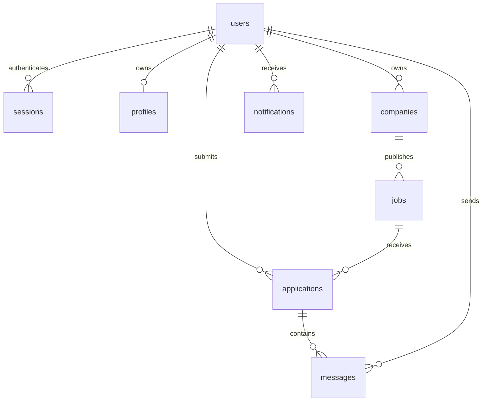

# Data model and migration plan

## Implemented schema

`app/schema.sql` is the executable SQLite v1 migration/bootstrap. Foreign keys enabled on every connection. IDs are random 128-bit hex strings. Passwords contain scrypt salt and digest; session table holds only SHA-256 token digests and Unix expiry. Sessions expire after one hour. Current candidate profile stores only confirmed skill names; raw CV is not persisted.

| Table | Key / constraint | Visibility |
|---|---|---|
| users | id PK; unique normalized email; constrained role/locale | self only |
| sessions | digest PK; FK user; expiry | server only |
| profiles | user PK/FK | self only |
| companies | id PK; owner FK | owner for mutation |
| jobs | id PK; company FK; status enum | open jobs public |
| applications | id PK; unique(job,candidate); status enum | candidate or job owner |
| messages | id PK; application/sender FKs | application parties |
| notifications | id PK; recipient FK | recipient only |

Transactions protect application creation + notification, and status update + notification. `BEGIN IMMEDIATE` serializes status checks and writes. Duplicate applications are rejected by a unique constraint, not only a pre-check. Notifications are durable inbox rows, not a processed push outbox. DB ownership restrictions are enforced by API queries, not SQLite row-level security.

## Target PostgreSQL extensions (not yet deployed)

| Entity | Essential fields / constraints |
|---|---|
| organization_members | organization_id,user_id composite unique; role; invited_by; accepted_at |
| invitations | organization_id,email,token_hash unique,expires_at,used_at |
| candidate_profiles | user_id unique; headline; country; visibility; version; updated_at |
| skills / profile_skills | canonical key; translated labels; evidence; proficiency; unique profile/skill |
| job_skills | job_id,skill_id unique; required/optional; weight constrained positive |
| job_translations | job_id,locale unique; title,description; human_verified |
| job_sources | provider,external_id unique; license_record_id; canonical_url; expires_at |
| resumes | owner_id; object_key unique; content_hash; scan_status; retention_until |
| analyses | resume_id; model/prompt version; state; result JSONB; consent_id; error_code |
| match_results | candidate_id,job_id,profile_version,job_version,model_version unique; explanations; expires_at |
| application_events | application_id; actor_id; from_status; to_status; timestamp; immutable |
| notification_preferences | user_id,channel,event_type unique; enabled; quiet_hours/timezone |
| devices | user_id; token encrypted; token_hash unique; platform; last_seen; revoked_at |
| outbox | event_id unique; type; reference_id; lease_until; attempts; next_attempt_at; state |
| deliveries | event_id,device_id unique; provider_message_id; status; error_code |
| consents | user_id; purpose; policy_version; granted_at; withdrawn_at |
| reports / blocks | reporter/target/reason; moderation status; unique blocker/blocked |
| audit_events | actor,action,resource,time; no raw CV or credentials |
| data_requests | user,type,state,requested_at,completed_at; export object TTL |

Use timestamptz, UUID and JSONB as appropriate. Store salary as numeric amount + currency + period, never floats or mixed currency sorting. PostgreSQL indexes: open jobs(country,remote,published_at,id), application(job_id,status,created_at), membership(user_id,organization_id), outbox(state,next_attempt_at), messages(application_id,created_at,id). Evaluate pgvector only after a multilingual relevance benchmark and extension/license review.

## Retention proposal requiring market review

CV retained while user chooses; superseded uploads delete after 30 days; failed quarantine files after 24h; exports expire after 24h; inactive tokens after 90 days; security logs 90 days; backups 30 days. Application and recruiter-message retention needs jurisdiction/business policy; do not promise immediate deletion where approved legal retention applies. Implement deletion tombstones reapplied after backup restores. No deletion endpoint is claimed in v0.1.

## Migration acceptance

Versioned forward migrations; explicit data conversion; test empty and populated databases; verify FK/unique constraints, Unicode, rollback compatibility and row counts. A restore drill plus concurrency tests on PostgreSQL are release blockers. The SQLite bootstrap does not automatically upgrade arbitrary old schemas.
